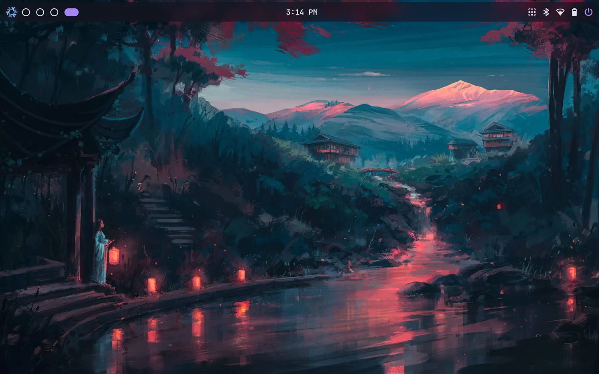
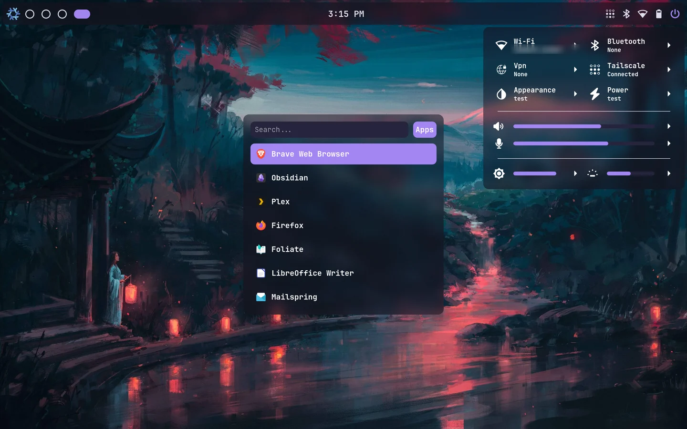
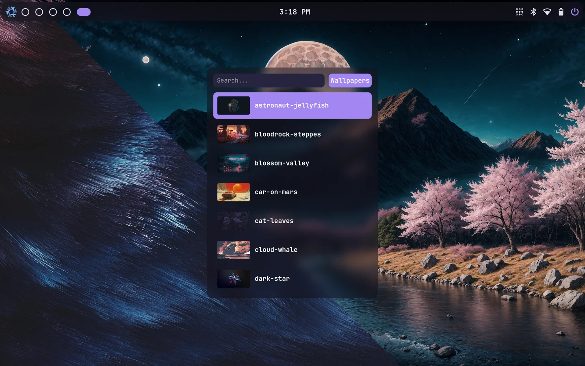
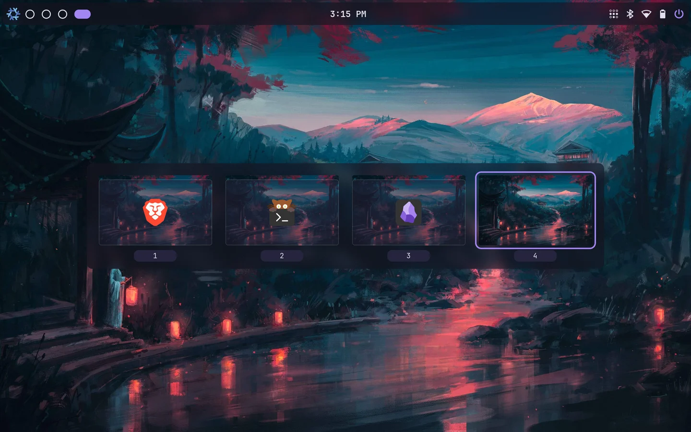
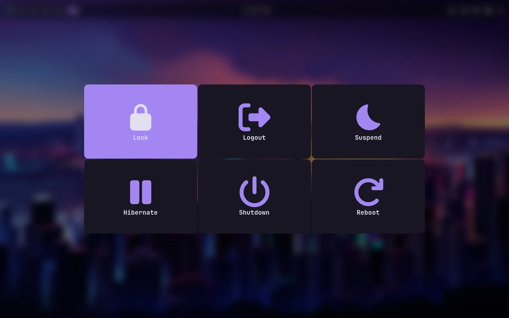

# ags-shell

A desktop shell for [Hyprland](https://hyprland.org), written in TypeScript/TSX on [AGS](https://github.com/aylur/ags) and [Astal](https://github.com/aylur/astal) (GTK4), packaged as a home-manager module.

> **Archived.** This was my daily desktop from 2025 until 2026-10-18, when I replaced it with a Quickshell (QML) shell ported from it. It's published as a reference and is not maintained.



| | |
|---|---|
|  |  |
|  |  |

## Features

- **Bar** - workspaces, clock, battery, Wi-Fi, Bluetooth, Tailscale, night-light and power indicators.
- **Launcher** - app search and a wallpaper picker with cached thumbnails; wallpapers are set through `awww`.
- **System menu** - network (Wi-Fi, VPN, Tailscale), Bluetooth, audio devices and volumes, brightness, media players, power and appearance pages.
- **Controller** - a workspace overview showing each window by its app icon; drag a window between workspaces.
- **Screen capture** - display, window or area capture, copied or saved, with an optional *Ask Claude* mode that sends the capture to the `claude` CLI and renders the answer as Markdown.
- **Notifications** - its own notification daemon (Astal notifd) showing popups in the corner.
- **Alerts** - on-screen indicators for volume, mic, brightness, keyboard backlight, battery, privacy mode and night light.
- **Logout menu**, **night light** via `hyprsunset`, and **privacy mode** for screen sharing: notification popups are suppressed, the bar and overview show only the current workspace, and the Tailscale indicator is hidden.
- Optional: matching **hyprlock** lock screen and **hypridle** idle ladder.

## Try it

On a Hyprland session using the Lua config (Hyprland 0.55+), stop your current bar and notification daemon, then:

```sh
nix run github:A0hijlxs/ags-shell
```

The shell registers its keybindings and layer rules for the session, and starts `awww-daemon` for wallpapers if none is running. Ctrl+C stops it, kills that `awww-daemon` and runs `hyprctl reload`, which puts your own binds and rules back. Settings come from the environment, with these defaults: `AGS_WALLPAPER_DIR=~/Pictures/Wallpapers`, `AGS_SCREENSHOT_DIR=~/Pictures/Screenshots`, `AGS_CACHE_DIR=~/.cache/ags`, `AGS_MAX_VOLUME=1.5`. `nix shell github:A0hijlxs/ags-shell` also gives you the `ags` CLI (`ags request launcher`, …). Night light needs a running `hyprsunset`.

## Install

Add the flake and import the home-manager module (and the NixOS module if you enable the lock screen, for its PAM service):

```nix
{
    inputs.ags-shell.url = "github:A0hijlxs/ags-shell";

    # NixOS configuration
    imports = [ inputs.ags-shell.nixosModules.default ];

    # home-manager configuration
    imports = [ inputs.ags-shell.homeManagerModules.default ];

    programs.ags-shell = {
        enable = true;
        wallpaperDir = "/home/me/Pictures/Wallpapers";
        lock.enable = true;
    };
}
```

The module runs the same package as the `ags-shell` systemd user service, bound to `graphical-session.target`, and enables `awww` and `hyprpolkitagent`; `reload-ags` restarts the shell.

| Option | Default | |
|---|---|---|
| `enable` | `false` | the shell and its service |
| `package` | this flake's | launcher, `ags` with the shell's libraries, helper scripts |
| `wallpaperDir` | `~/Pictures/Wallpapers` | directory the wallpaper picker lists |
| `screenshotDir` | `~/Pictures/Screenshots` | where captures are saved |
| `cacheDir` | `~/.cache/ags` | state and thumbnails |
| `maxVolume` | `1.5` | volume ceiling (1.0 = 100%) |
| `lock.enable` | `false` | hyprlock + hypridle |
| `lock.background` | `null` | lock background image; `null` blurs the desktop |
| `lock.fingerprint` | `false` | fingerprint unlock and prompt |
| `lock.keyboardBacklight` | `null` | `brightnessctl` device dimmed when idle |
| `lock.autosuspend` | `true` | suspend after long idle |

The shell registers its own keybindings and layer rules with Hyprland at startup, and again after every config reload, so there is nothing to add to your Hyprland config. It targets Hyprland's Lua config (`hl.*` API, Hyprland 0.55+); it does not work with a hyprlang config.

| Keys | Action |
|---|---|
| `SUPER + space` | launcher |
| `SUPER + K` | system menu |
| `SUPER + Z` | controller (workspace overview) |
| `SUPER + P` | logout menu |
| `SUPER + B` | toggle the bar |
| `SUPER + SHIFT + P` | privacy mode |
| `SUPER + L` | lock (when hyprlock is installed) |
| `SUPER + A` | restart the shell |
| `Print` | screenshot of the display, saved to the screenshot directory |
| media keys | volume, mic mute, brightness |

## Layout

```
config/       the shell: app.ts entry, src/widget/ (one folder per surface), src/store/ (state, services, hypr.ts for Hyprland), src/scss/
nix/          package.nix (launcher + ags + scripts), module.nix (home-manager), nixos.nix, hypr/ (hyprlock, hypridle), scripts/
```

## Credits

Built on [AGS](https://github.com/aylur/ags) and [Astal](https://github.com/aylur/astal) by Aylur.

The symbolic icons in `config/src/icons/` come from the open-source sets below, mostly by way of [Iconify](https://iconify.design). Many were modified: recoloured, recropped, renamed, or combined (the battery and Wi-Fi state variants are built from Material Design Icons glyphs). Each icon keeps its set's licence.

| Set | Author | Licence | Files |
|---|---|---|---|
| [Material Design Icons](https://github.com/Templarian/MaterialDesign) | Pictogrammers | Apache-2.0 | `mdi-*` |
| [Material Symbols](https://github.com/google/material-design-icons) (incl. Light) | Google | Apache-2.0 | `ms-*`, `msl-*` |
| [Font Awesome 4](https://github.com/FortAwesome/Font-Awesome/tree/fa-4) | Dave Gandy | OFL-1.1 | `fa-*` |
| [Font Awesome 6 Free](https://github.com/FortAwesome/Font-Awesome) | Fonticons | CC BY 4.0 | `fa6-*` |
| [Streamline Plump](https://github.com/webalys-hq/streamline-vectors) | Streamline | CC BY 4.0 | `plump-*` |
| [Carbon](https://github.com/carbon-design-system/carbon) | IBM | Apache-2.0 | `carbon-*` |
| [Unicons](https://github.com/Iconscout/unicons) | Iconscout | Apache-2.0 | `uis-*` |
| [IconPark](https://github.com/bytedance/IconPark) | ByteDance | Apache-2.0 | `ipo-*` |
| [Charm Icons](https://github.com/jaynewey/charm-icons) | Jay Newey | MIT | `charm-*` |
| [Eva Icons](https://github.com/akveo/eva-icons) | Akveo | MIT | `eva-*` |
| [Framework7 Icons](https://github.com/framework7io/framework7-icons) | Vladimir Kharlampidi | MIT | `f7-*` |
| [Fluent UI System Icons](https://github.com/microsoft/fluentui-system-icons) | Microsoft | MIT | `fluent-*` |
| [css.gg](https://github.com/astrit/css.gg) | Astrit | MIT | `gg-*` |
| [Myna UI Icons](https://github.com/praveenjuge/mynaui-icons) | Praveen Juge | MIT | `myna-*` |
| [Octicons](https://github.com/primer/octicons) | GitHub | MIT | `octicon-*` |
| [Teenyicons](https://github.com/teenyicons/teenyicons) | smhmd | MIT | `tick-*` |
| [Reicon](https://github.com/dqev/reicon) | REICON | MIT | `solar-route-*` |
| [Lucide](https://github.com/lucide-icons/lucide) | Lucide Contributors | ISC | `lucide-*` |
| [File Icons](https://github.com/file-icons/icons) | John Gardner | ISC | `fi-*` |
| [Devicon](https://github.com/devicons/devicon) | konpa | MIT | `nixos*` |
| [theSVG](https://github.com/glincker/thesvg) | thesvg.org | MIT | `si-wireguard-*` |

The NixOS, Tailscale and WireGuard logos are trademarks of their respective owners and are used only to label those services. `night-mode-*` and `bluetooth-device-*` are adapted icons whose origin wasn't recorded.

## Licence

[MIT](LICENSE), except the bundled icons, which keep their own licences (see Credits).
